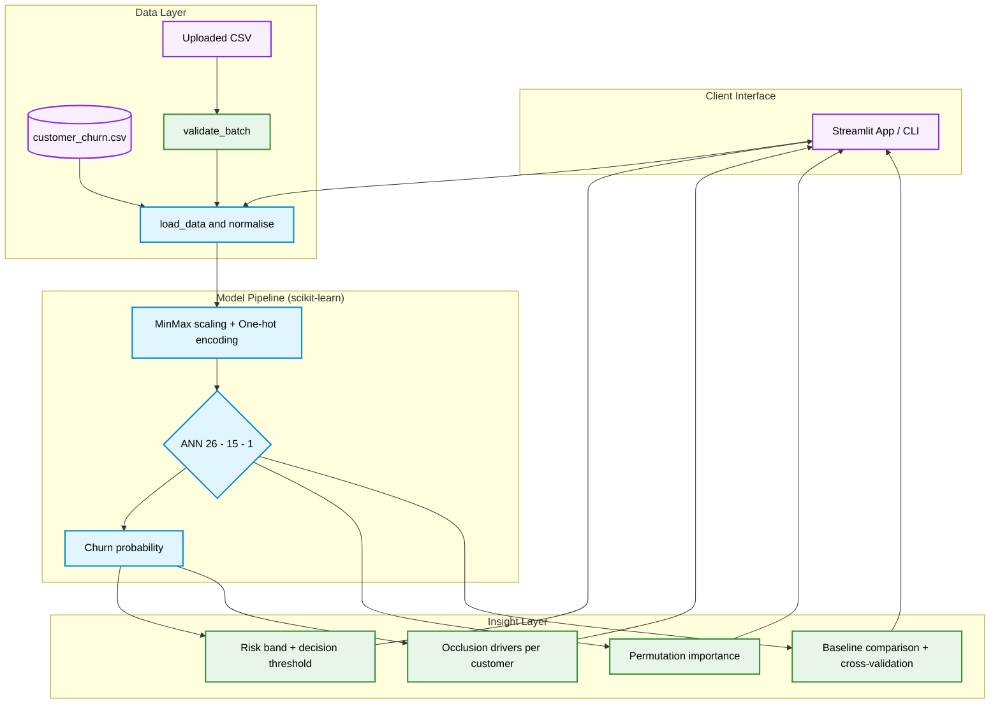

# Customer Churn Prediction

An interactive telecom churn predictor: an ANN classifier with per-customer explanations, batch scoring and model diagnostics, served through Streamlit.

> **Live Deployments:**
> * **Interactive Streamlit App:** [customer-telecom-churn.streamlit.app](https://customer-telecom-churn.streamlit.app/)

---

## Overview

Customer churn is the rate at which customers discontinue subscriptions. This project trains an Artificial Neural Network (ANN) on 7,043 telecom customer accounts (~27% churn rate) and wraps it in an interactive Streamlit application. Users can score individual customers, analyze individual risk drivers, score uploaded batch CSV files, explore demographic distributions, and inspect diagnostic performance metrics.

---

## Architecture Overview



---

## Features

| Feature | Description |
| ------- | ----------- |
| **Single-Customer Scoring** | Interactive form with presets; shows churn probability, risk band, binary classification decision, and top factors driving risk |
| **Batch CSV Evaluation** | Upload custom CSVs for automated schema validation, scoring, distribution histograms, and downloadable predictions |
| **Adjustable Decision Threshold** | Real-time threshold slider adjusting precision and recall trade-offs across all views |
| **Exploratory Data Browser** | Categorical churn rates and tenure/charge distribution overlays comparing churned vs. retained cohorts |
| **Comprehensive Model Diagnostics** | Confusion matrix, ROC-AUC curves, threshold curves, permutation feature importances, and 5-fold cross-validation |
| **Leak-Free ML Pipeline** | Stratified train/test splits, scalers fitted strictly on training data, early stopping validation, and majority-class baselines |
| **Resilient Input Validation** | Tolerates unseen categorical values, imputes missing charges, and isolates malformed batch rows |

---

## Technology Stack

| Component | Technologies |
| :-------- | :----------- |
| **Modeling** | `scikit-learn` (`MLPClassifier`, pipelines, cross-validation) |
| **Data Handling** | `Pandas`, `NumPy` |
| **Frontend UI** | `Streamlit` |
| **Visualisation** | `Altair` |
| **Testing & Quality** | `pytest`, Streamlit `AppTest`, `ruff`, `mypy` |
| **Containerization** | `Docker`, Dev Containers |

---

## Project Structure

```
Customer-Churn-Prediction/
├── app.py                      # Streamlit application entrypoint
├── churn/
│   ├── __init__.py             # Package initialization
│   ├── __main__.py             # CLI entrypoint (python -m churn)
│   ├── charts.py               # Altair visualization builders
│   ├── cli.py                  # Training, evaluation, and batch prediction CLI
│   ├── config.py               # Paths, column groupings, and hyperparameter configs
│   ├── data.py                 # Ingestion, cleaning, encoding, and schema validation
│   ├── explain.py              # Per-customer occlusion driver analysis
│   └── model.py                # Pipeline definition, training loop, and scoring
├── data/
│   ├── customer_churn.csv      # Source dataset (7,043 customer records)
│   └── sample_customers.csv    # 200 unlabeled rows for batch testing
├── tests/
│   ├── conftest.py
│   ├── test_data.py            # Data cleaning and encoding tests
│   ├── test_model.py           # Model quality, determinism, and leakage tests
│   ├── test_explain_charts_cli.py
│   ├── test_notebook.py
│   └── test_app.py             # Streamlit AppTest scenario tests
├── Dockerfile                  # Container definition (runs as unprivileged user)
├── Makefile                    # Developer shortcuts (install, test, lint)
├── pyproject.toml              # Tooling and dependency configuration
└── README.md
```

---

## Setup and Installation

### Prerequisites

- Python 3.10+
- pip package manager

### 1. Clone the repository

```bash
git clone https://github.com/Shashank17singh/Customer-Churn-Prediction.git
cd Customer-Churn-Prediction
```

### 2. Install dependencies

```bash
python -m venv .venv
# Linux / macOS:
source .venv/bin/activate
# Windows:
.venv\Scripts\activate

pip install -r requirements.txt
```

No external API keys are required; the model trains locally in seconds.

### 3. Run the application

```bash
streamlit run app.py
```

### 4. Command-Line Interface

```bash
# Train model and export serialized artifact
python -m churn train

# Run diagnostic evaluation and print cross-validation metrics
python -m churn evaluate

# Batch score customer records
python -m churn predict data/sample_customers.csv
```

---

## Model Results

Evaluated on a stratified 20% hold-out set (1,409 customers) at the default 0.5 threshold:

| Model | ROC-AUC | Precision | Recall | F1 | Accuracy |
| :---- | :-----: | :-------: | :----: | :-: | :------: |
| **ANN (26-15-1)** | 0.832 | 0.617 | 0.492 | 0.548 | 0.784 |
| Logistic Regression | 0.841 | 0.642 | 0.551 | 0.593 | 0.799 |
| Random Forest | 0.841 | 0.648 | 0.516 | 0.574 | 0.797 |
| Gradient Boosting | 0.834 | 0.642 | 0.545 | 0.590 | 0.798 |

Five-fold cross-validation of the ANN: ROC-AUC 0.839 ± 0.015, recall 0.539 ± 0.034.

---

## Running the Tests

Execute automated test suites:

```bash
pytest tests/
```

Run static code analysis and type checking:

```bash
ruff check .
mypy churn
```

---

## Deployment

The application is containerized and configured for unprivileged execution:

```bash
docker build -t churn-predictor .
docker run --rm -p 8501:8501 churn-predictor
```

Live deployment is hosted on Streamlit Community Cloud at [customer-telecom-churn.streamlit.app](https://customer-telecom-churn.streamlit.app/).

---

## Known Limitations

- Model probabilities estimate relative retention risk rather than deterministic causation; individual drivers measure marginal feature occlusion against average customer medians.
- The training corpus represents a static telecom distribution; changing pricing plans or competitive alternatives requires ongoing dataset replenishment.

---

## License

This project is licensed under the MIT License. See [LICENSE](LICENSE) for details.
